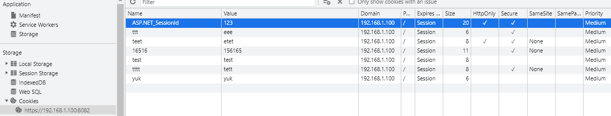
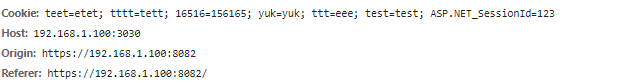
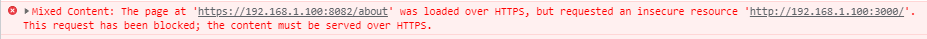
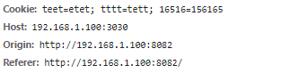
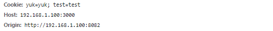

https://www.chromium.org/updates/same-site

Chrome 會將沒有對 Cookie SameSite 屬性的 Cookie 預設加入 SameSite=Lax 的屬性，這會致使不相同的網站，無法再透過 Get 以外的請求取得到 Cookie ，因此對外站進行 POST 請求；
如果要避免這問題，就必須將 SameSite 屬性設為 SameSite=None; secure，並且透過 Https 進行資料傳輸，就能避免 Cookie 在不同網站能被存取且又能安全傳遞資料。如果沒加上 secure ，一樣僅能透過 Https 運作。


```javascript
fetch("http://192.168.1.100:3030", {
      method: "POST",
      credentials: "include",
    });
    
// axios
postRequest(context: any, params: axiosParams) {
    return axios({
      // method: "post",
      url: `${base}${params.url}`,
      data: params.data,
      withCredentials: true,
    });
  }
```



* Origin:https - Host:https


* Origin:https - Host:http



* Origin:http　- Host:https


* Origin:http　- Host:http

